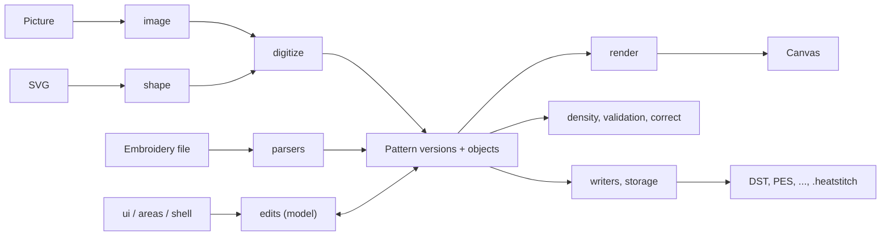
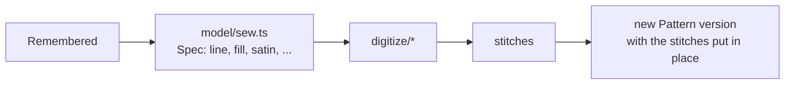
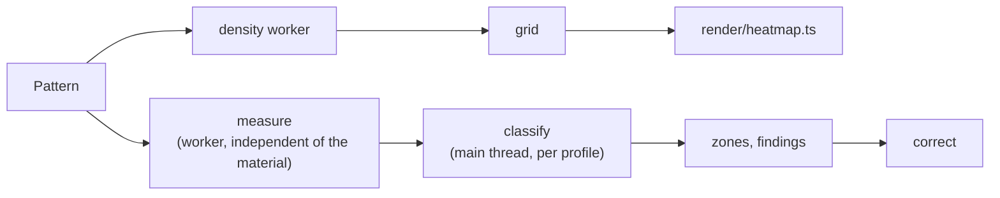

# Architecture

This is a map of the heatstitch codebase for contributors: what lives where, how data moves from a
file to the screen and back, and which rules hold the parts together. For setup, tests and
conventions see [CONTRIBUTING.md](CONTRIBUTING.md); for what the app does see the
[README](README.md).

## The big picture

heatstitch is a static web app. There is no backend: everything (reading files, sewing new
stitches, checking, correcting, writing files) runs in the browser. The interface and the state of
a design are TypeScript; the computing is a Rust crate built to WebAssembly (`core/`, see
[The compute core](#the-compute-core-core) below). There is no UI framework; the interface is
plain DOM and canvas, built by small modules.



The code falls into three layers:

| Layer | Directories | Rule |
|---|---|---|
| **Core** (pure logic) | `model`, `shape`, `digitize`, `image`, `parsers`, `writers`, `validation`, `correct`, `density`, `lettering`, `material`, `threads`, `library`, `resew` | No DOM, no UI imports. Runs in Node (tests) and in Web Workers. |
| **Presentation** | `render`, `ui`, `areas`, `shell`, `i18n` | Draws the canvas, builds panels, registers commands. |
| **Wiring** | `main.ts`, `app/`, `settings.ts`, `storage/` | Holds app state, connects input, core and presentation. |

Core modules never import from `ui`, `areas`, `app`, `render` or `shell`. Keep it that way: it is
what lets the torture test and the workers use the same code as the app.

Most of the core layer is a thin TypeScript face on the Rust crate: the modules keep their names
and exports, hand plain data to the crate and turn what comes back into the app's types. What
stays TypeScript is listed in the next section.

## The compute core (`core/`)

```
core/Cargo.toml        The crate heatstitch-core (rust-toolchain.toml pins the Rust it is built with)
core/src/<area>/*.rs   Pure Rust, one module per TypeScript module it replaced, with its unit tests:
                       image, shape, digitize, model, density, validation, correct, lettering,
                       parsers, writers, material
core/src/bind/*.rs     The WebAssembly exports (wasm-bindgen), one file per area, thin
core/src/js.rs         Arithmetic as JavaScript does it (Math.hypot, Math.round, ToInt32, mulberry32)
core/src/trig.rs       sin, cos and pow bit for bit as V8 has them, on every platform
src/wasm/core.ts       Loads the module: loadCore() in the app and each worker, on its own in Node
src/wasm/pkg/          Built by `npm run wasm` (wasm-pack), ignored by version control
```

- **Loading.** The exports are synchronous. The app awaits `loadCore()` before its first
  computation (`main.ts`), each worker before its first message. In Node (tests, tools) `core()`
  instantiates the module from the file on first use. Until the app is set up, a splash in
  `index.html` covers the page (style, texts and a small script inline, so it shows from the first
  paint; `src/ui/boot.ts` drives it): the app's `loadCore(bootProgress)` reports the download as it
  streams in (`src/wasm/progress.ts`, against the built size when the server compresses), the built
  page preloads the core beside the app's script (`vite.config.ts`), and a failed load ends in a
  message with a reload button. Its texts are in `src/i18n/areas/boot.ts`; the build writes both
  languages into the page (`src/build/boot.ts`).
- **Data across the boundary.** Records cross as typed arrays (`Int32Array` x and y,
  `Uint8Array` commands), points as `Float64Array` x, y pairs with a lengths array per run,
  regions as their pixel fields (`regionIn` in `digitize/region.ts`). Settings, forms and
  results with structure cross as plain objects (serde). Results that hold several arrays are
  wasm-bindgen objects that the caller takes apart and frees (`take*()`, `free()`). The boundary
  is crossed per object, per region or per design, never per point.
- **Coarse entry points.** One call sews an object (`sewOne`), a lettering, a picture's regions or
  a fill; one call measures a design (`measurePattern`), builds its density grid, reads or writes
  a file, or runs a correction step.
- **What stays TypeScript.** The interface (`ui`, `areas`, `render`, `shell`, `i18n`, `app`), the
  state of a design (pattern versions, the object table and what objects remember in
  `model/objects.ts`, undo), the caches, the workers and their clients, the SVG reader
  (`image/svg.ts` lets the browser draw the file), node editing (`shape/join.ts`,
  `shape/nodeOps.ts` and the node helpers of `shape/path.ts`), loading and placing fonts, storage,
  and small helpers the interface calls per point (`sample` in `digitize/region.ts`, the color
  conversions in `image/color.ts`, the cross stitch grid in `digitize/deco.ts`).
- **Shared pieces of the crate**: `geom` (points, vector and polyline helpers), `pattern` (records
  and colors), `shape::path` (forms, curves, flattening, `inside_poly`), `image::color` (Lab,
  CIEDE2000), `js` and `trig`. Use and extend them instead of writing a helper again.
- **Where to put new computing.** In the crate, with unit tests (`cargo test`); export it from
  `bind/` only when TypeScript needs it, as a coarse call, and keep the TypeScript side a wrapper.
  The crate builds for speed (`opt-level = 3`), with `strip` and `panic = "abort"` for size.

`npm test`, `npm run build`, `npm run dev` and `npm run typecheck` build the module first
(`scripts/wasm.mjs`). CI builds it once per run (`.github/actions/core`) and hands it to the other
jobs (`CORE_PREBUILT`), and runs `cargo fmt`, `cargo clippy` and `cargo test` on the crate. How the
TypeScript was moved over, stage by stage, is in [docs/rust-core.md](docs/rust-core.md).

## Repository layout

```
src/            The app (see below)
core/           The compute core in Rust, built to WebAssembly (docs/rust-core.md)
tests/          Vitest tests, synthetic fixtures (tests/helpers), the torture test, benchmarks
public/         Static files: examples, fonts, motif library, thread catalogs, guide pictures, tips
tools/          Node scripts that produce files in public/ or docs/ (fonts, motifs, threads,
                guide shots, tooltip pictures, screencasts, recordings, icons, moving page)
scripts/        Test helpers outside Vitest (pystitch oracle, test timings)
docs/           Terms (terms.md), session recording, screencast scripts, screenshots
design-system/  The UI design system (MASTER.md) and interface concept
cloudflare/     The Worker that serves the site and the page of closed PR previews
index.html, docs.html, videos.html, video.html, releases.html
                The app, the guide, the video page, the per-video template and what is new
CHANGELOG.md    The release notes, both languages (releases.html, GitHub releases)
```

## The data model (`src/model/`)

### Pattern: records and versions

Everything starts at `Pattern` in `src/model/pattern.ts`: the stitches of a design as flat typed
arrays, one entry per record.

- `x`, `y` (`Int32Array`): absolute coordinates in 0.1 mm, y pointing down.
- `cmd` (`Uint8Array`): `STITCH`, `JUMP`, `TRIM`, `COLOR_CHANGE`, `END`.
- `colors`: one thread per color block.

This is close to what the machine formats store, so every parser produces it and every writer
consumes it. Screen and shape code works in millimetres (`records / 10`).

**The records of a pattern are never changed in place.** An edit makes a new *version* with
`nextVersion(p, changes)` (or `withRecords`). Each version remembers its parent (`parentOf`).
Undo and redo are lists of earlier and undone versions per file (`src/ui/fileList.ts`), trimmed by
count and memory (`trimUndo`).

What a version knows about its objects (see below) is kept beside it in a `WeakMap`. While a
version is being made it can still learn (`remember`, `setMemory`); once the file list keeps it
(`keepVersion`), its knowledge is settled, and writing to it throws in development. To learn
something about a kept version, make a new one with `relearn(p, learn)`: it copies the knowledge,
lets `learn` change it and returns the new version for undo. `backToVersion` puts the kept
knowledge back on undo, redo or switching designs, and `hold()` does the same for tries that must
leave no trace (all in `src/model/objects.ts`). Undo restores records and knowledge together, all
or nothing.

### Objects

A design is a sequence of **objects** (a fill, a satin column, a running stitch line, ...). The
object list of each version lives in a `WeakMap` keyed by the pattern (`src/model/objects.ts`,
`Table` and `Entry`). Every object has a fixed `id` that survives every edit, the record range
it is sewn in, and optionally a memory (`Remembered`).

`sewObjects(p)` returns the objects of a version in sewing order. A new version takes the objects
over from its parent; only stitches that are new and that nobody described are recognized from the
stitches themselves, as for a file from other software (digitizers trim between objects, so the
stitches between two trims are a section of one object).

### What an object knows: known and guessed

`Remembered` (`src/model/restitch.ts`) is what an object knows about itself: its form (`geo`, a
vector `Form` from `src/shape/path.ts`), its stitch type and settings (`fill`, `satin`, `line`,
...), its links to other objects (border, blend, knockout, lettering, appliqué) and what it was set
to before.

The model keeps **known** and **guessed** structure apart:

- *Known*: the object was drawn, imported from SVG, made by the image assistant or lettering, or
  its form was edited. `geo` is the single source of its geometry; the pixel `region` used for
  filling is rastered from it, never the other way round.
- *Guessed*: the object came from an embroidery file (or was read from stitches when first
  edited by hand). Its shape is inferred from the stitches. `isGuessed(p, o)` tells which.

`src/model/original.ts` keeps the way back to the stitches an object had in the loaded file.

### Sewing anew

When settings or a form change, the object is sewn anew from what it remembers:



`src/model/restitch.ts` (settings changes), `src/model/sew.ts` (sewing one object or a whole design
from its object list) and `src/model/shapeOps.ts` (duplicate, mirror, delete, cut out, recolor,
...) are the main entry points. Related objects follow their leaders in the same step: borders
(`border.ts`), knockouts under later fills (`knockout.ts`), derived areas (`derived.ts`), appliqué
(`applique.ts`, edges shared by touching appliqués in `appliqueShare.ts`), echoes and shadows (`shadow.ts`).
Hidden travel (`travel.ts`): the way between neighbours in one thread runs as running stitch under
the dense fills and satins from 2 mm sewn later where the travel grid finds one 0.5 mm inside them;
it belongs to the object it leads to (`Remembered.travel`, its first stitches), `sewList` plans and
keeps it, and `settleTravel` finds it again after edits made without the list (borders, added
shapes, pictures). `withHiddenJoins` lists the hidden ways as transitions for the jumps panel and
the stage; `joinsAs` trims one by hand (`Remembered.cutIn`: never hidden again) or hides it again.

Other model modules: `transform.ts` and `reshape.ts` (move, rotate, scale), `order.ts` and
`bestOrder.ts` (sewing order), `jumps.ts` (trims and ties), `sequence.ts` (stitch kinds and color
blocks derived from the records alone), `hoop.ts`, `recolor.ts`, `handEdit.ts` (single needle
points), `addShape.ts`, `appendDesign.ts`.

Sewing along lines and borders (`along.ts`, `line.ts`), satin from its rails (`satinRuns`,
`bestChain` and their helpers in `restitch.ts`), fills from their settings (`fillRuns`) and
appliqués (`appliqueRuns`) run in the Rust core (`core/src/model/`), and so does `sewOne`: one
call per object, with the whole area it was cut from and what covers it looked up here. Areas
traced from stitches (`traceRegion`) and grown (`grownArea`), the hidden way on its grid (the
cells under the hiding areas are sampled here) and the order the optimizer plans
(`planCandidates`) are the core's too. The TypeScript functions keep their names, pass plain specs
and mark the runs they get back for a trim (`trimBefore`) or a stop (`stopBefore`); pattern
versions, what objects remember, the caches and undo stay here.

## Shapes and digitizing

- **`src/shape/`**: vector forms. Paths of nodes with cubic curves (`path.ts`), SVG path data
  (`svgPath.ts`), boolean operations and offsets (`ops.ts`), rasterizing, vectorizing and
  simplifying, and a constrained Delaunay triangulation with exact predicates (`cdt.ts`). The
  computing is done by the Rust core (`core/src/shape/`: booleans on the curves with `linesweeper`,
  offsets with `clipper2-rust`); joining paths and editing nodes (`join.ts`, `nodeOps.ts`, the
  node helpers of `path.ts`) stay TypeScript.
- **`src/digitize/`**: stitch generation. Fill variants (`fill.ts`, `flow.ts`, `spiral.ts`,
  `rings.ts`, `deco.ts`, `echo.ts`), satin (`satin*.ts`, `rungs.ts`, `skeleton.ts`; a wide area
  as arms and hubs along its medial axis on the outline in `medial.ts` and `satinInner.ts`), running
  stitch and hand stitches (`run.ts`, `motif.ts`, `redwork.ts`), borders, and the image pipeline
  entry `digitize.ts` with the *Smart* style in `smart.ts`.
- **`src/image/`**: preparing a picture for embroidery: color spaces and CIEDE2000, filters,
  quantization, label maps, distance transforms, orientation, SVG reading (`prepare.ts` is the
  staged, cached pipeline).
- **`src/lettering/`**: fonts (converted from Ink/Stitch, see `tools/fonts/`), layout on lines,
  arcs and circles, sewing letters and placing them into a design. Layout and sewing (with what
  overlapping letters leave out) run in Rust (`core/src/lettering/`, one call per lettering, the
  font handed over once); loading fonts, drawing and placing stay TypeScript.
- **`src/library/`**: the motif library (Twemoji sewn as designs).

Picture to design: `image/prepare.ts` reduces the picture to thread colors and regions, the
digitize worker turns regions into objects, and `model/digitized.ts` turns the result into a design
whose objects remember what they were made as.

## Reading and writing files

- **`src/parsers/`**: `index.ts` (`parsePattern`) reads a file with the core
  (`core/src/parsers/`: DST, PES/PEC, JEF, VP3, EXP, XXX, SEW and their thread palettes), which
  picks the format by content (PES, PEC, VP3) or file name. Parsed designs are marked with
  `readFromFile`, so their objects are recognized from stitches.
- **`src/writers/`**: own writers for DST, PES/PEC, JEF, VP3, EXP and XXX (no pyembroidery), in
  `core/src/writers/`; `index.ts` (`writePattern`) picks one.
  Round trips read, write, read must stay record-equal (`tests/writers.test.ts`), and CI checks
  the output against pystitch as an independent reader (`tests/oracle.test.ts`).
- **`src/storage/`**: `fileStore.ts` and `imageStore.ts` keep loaded files, edits and the picture
  in IndexedDB across reloads; `project.ts` encodes the `.heatstitch` project file, which holds
  everything embroidery formats drop (object memory, settings, letterings, acknowledgements,
  material). Raise its version when older versions would misread new content.
- **`src/send/`**: handing a file to the machine (download, share, USB stick, Ember Bridge).

## Checking and correcting



- **`src/density/`**: the density grid (thread length or needle points per mm²) and its blur,
  computed in Rust (`core/src/density/`).
- **`src/validation/`**: `measure.ts` measures once per design, in one call to Rust
  (`core/src/validation/`: density, satin, short stitches, penetrations, coverage and gaps, with
  the stitch kinds they need); `validate.ts` classifies the
  measurement with a material profile (`profiles.ts`, `thresholds.ts`) cheaply on the main thread,
  so changing fabric or thread reruns instantly. Rules for short stitches, satin, coverage, zones,
  practice rules and acknowledgements live next to it.
- **`src/material/`**: fabrics, threads and the rules derived from them.
- **`src/correct/`**: the correction. `plan.ts` proposes new object settings (spacing, underlay,
  pull compensation, knockouts) and sews them anew; the fine corrections on raw stitches are in
  `pullback.ts`, `respace.ts`, `thin.ts`, `shorts.ts` and friends, each one call to Rust
  (`core/src/correct/`). `correct/engine/` is the solver behind *Will it stitch?* (cells,
  variants, a MIP solver, validation), run in workers; its additive field and the search over the
  variants are in Rust (`core/src/correct/engine/`), sewing the variants stays in TypeScript.

## Web Workers

Heavy work runs off the main thread. Each worker has a `client.ts` next to it that wraps it in
promises; requests carry plain data (typed arrays, stored objects) that `postMessage` can clone.

| Worker | Does |
|---|---|
| `src/density/worker.ts` | density grid, validation measurement, automatic correction (two instances: density and validator) |
| `src/digitize/worker.ts` | picture to stitches for the image assistant |
| `src/resew/worker.ts` | a design sewn anew off the main thread: scaled while the frame is dragged and when it is let go, stitch settings pointed at and taken over; for many fills, a share of them on each of a few helper cores (`pool.ts`), taken over stitch for stitch (`Fills` in `model/restitch.ts`) |
| `src/correct/engine/worker.ts` | the traffic light report and fixes, several workers at once |

A new design (an edit) drops work still running for an older version, so the newest design never
waits behind an old one.

## Rendering (`src/render/`)

`viewport.ts` maps world millimetres to CSS pixels. `scene.ts` draws a frame from a `Scene`:
stitches (`stitches.ts`, colored by thread, order, kind or length), realistic threads and fabric
in WebGL2 (`threadsGl.ts`, `fabricGl.ts`, `light.ts`), the heatmap and legend, and overlays for
shapes, rungs, editing, validation zones, the hoop, measuring and the compare view.

## The interface

- **`src/main.ts`** starts the app: it creates the file list, workers, viewport and panels, and
  calls the `bind*` functions in `src/app/`. Each `app/` module declares what it needs from the
  rest of the app as a small interface (`SceneApp`, `DesignApp`, ...) instead of importing it.
- **`src/app/state.ts`** holds the state several parts share: selection, hover, views, what is
  being edited.
- **`src/shell/`** is the frame of the interface. Every action is a **command**
  (`shell/commands.ts`): a button, a menu entry, a key and the command search (`Ctrl+K`) all run
  the same command and are enabled by the same rule. Also popovers, tooltips and `signal.ts` for
  small reactive values.
- **`src/areas/`**: the areas of the interface (files and start page, design card, objects,
  shapes, stitches, library, check, traffic light, ready to stitch, measure, responsive layouts).
  Each registers its own commands.
- **`src/ui/`**: panels and tools the areas use: object and stitch panels, layers, player, editor,
  draw, shape, rung, frame and measure tools, thread picker, validation and correction panels,
  the image assistant (`imageMode.ts`) and `fileList.ts` (open designs, versions, undo).
- **`src/i18n/`**: all user-facing text in German (`de.ts`, defines the keys) and English
  (`en.ts`), with per-area files in `i18n/areas/`. The language switches without a reload. See
  CONTRIBUTING for the rules and `docs/terms.md` for the terms.
- **Design system**: `design-system/heatstitch/MASTER.md` (colors, type, components) and
  `konzept.md` (interface concept). `src/shell/ui.ts` and the CSS follow it.
- **`src/dev/`**: the developer console (`heatstitch` in the browser console) and the session
  recorder used to reproduce bugs and script screencasts (`docs/aufzeichnung.md`).

## Guide, videos and build

`docs.html` (guide), `videos.html`, `video.html`, `releases.html` (what is new) and `privacy.html`
(privacy policy) are separate pages with their own entry scripts (`src/docs.ts`, `src/videosPage.ts`,
`src/videoWatch.ts`, `src/releasesPage.ts`, `src/privacyPage.ts`). The Vite build
(`vite.config.ts`) writes every page once per language: English at the root, German under `de/`
(`src/build/langPages.ts`), plus one page per video and `sitemap.xml`. `vite-plugin-pwa` makes the
app installable and offline capable.

`releases.html` (what is new) is written from `CHANGELOG.md` by `src/build/changelog.ts`. The build
also sets the version and where it runs (`src/build/version.ts`: release, beta, preview or dev, from
the git tag and `CHANNEL`), which the app shows in its menu and as the beta badge (`src/ui/version.ts`).

`.github/workflows/deploy.yml` runs the tests (sharded, plus browser tests, the pystitch oracle and
the correction benchmark), builds the site and deploys `develop` to beta.heatstitch.app (Cloudflare,
`wrangler.jsonc`). heatstitch.app gets a published release (`release.yml`). Every pull request gets a
preview at its own address; see CONTRIBUTING.

## Tests (`tests/`)

- **Unit tests** run in Node with Vitest, on synthetic fixtures from `tests/helpers/` (encoded
  files, shapes, designs, images). Only a few tests open a real browser (`BROWSER_TESTS=1`).
  The Rust crate has unit tests of its own per module (`cargo test` in `core/`).
- **Whole designs** (`tests/sewHashes.test.ts`): the example designs sewn anew, as they are and
  scaled, must give the stitches recorded in `tests/fixtures/sew-hashes.json`. A change that
  moves stitches on purpose records them anew (see the test).
- **The torture test** (`tests/helpers/torture.ts`, run by `torture*.test.ts`) plays random chains
  of the operations the app offers (add, duplicate, mirror, scale, cut out, knock out, recolor,
  border, lettering, motifs, undo, redo, save and open, export, ...) the way the app does them, and
  checks the design's invariants after every step (`checkWellFormed`, `checkObjectList`,
  `checkBorders`, `checkKnockouts`, `checkFollowers`, `checkTravel`, `checkExport`, ...). A failing chain prints
  its seed and steps, so it can be replayed and turned into a regression test in the
  "found by the torture test" block. `TORTURE_CHAINS=10000` runs a long session.
- **Demos** (`tests/demos.test.ts`): the guide's demo files are generated and must stay current.
- **Benchmarks**: `tests/korrekturBench.test.ts` and `tests/bench/` measure the correction.

## Quick reference

Entry points worth knowing by name:

| What | Where |
|---|---|
| Read a file into a design | `parsePattern(data, fileName)` in `src/parsers/index.ts` |
| Write a design to a format | `writePattern(p, format)` in `src/writers/index.ts` |
| New version from new records | `withRecords(p, x, y, cmd)` in `src/model/edit.ts`, `nextVersion(p, changes)` in `src/model/pattern.ts` |
| Objects of a version | `sewObjects(p)` in `src/model/objects.ts` |
| What an object knows, guessed or not | `remembered(p, o)`, `isGuessed(p, o)` in `src/model/restitch.ts` |
| Sew objects anew with new settings | `restitch(...)` in `src/model/restitch.ts` |
| The order of a satin part (steps, joins; reorder, cut, turn, mirror) | `partSteps(...)`, `moveStep`, `cutStep` in `src/model/satinOrder.ts` |
| Sew one object, or a design from its object list | `sewOne(spec, way)`, `sewDesign(p, trimMm)` in `src/model/sew.ts` |
| Add a drawn or imported shape | `addShape(p, shape, color, after, options)` in `src/model/addShape.ts` |
| Move, rotate, scale | `transformObjects(p, sel, m, trimMm)` in `src/model/reshape.ts` |
| Duplicate, mirror, delete, cut out, recolor | `src/model/shapeOps.ts` |
| Borders and knockouts follow their objects | `syncBorders(p, trimMm)` in `src/model/border.ts`, `setKnockout(...)` in `src/model/knockout.ts` |
| Project file | `encodeProject(project)`, `decodeProject(bytes)` in `src/storage/project.ts` |
| Measure and classify | `measurePattern(p)` in `src/validation/measure.ts`, `classify(m, profile, checks)` in `src/validation/validate.ts` |
| A user-facing text | `t('key', vars)` in `src/i18n/index.ts`, keys defined in `src/i18n/de.ts` |
| A command (button, key, search) | `command({...})` in `src/shell/commands.ts` |

Running only what a change touches (the full suite takes a while):

```sh
npx vitest run tests/writers.test.ts          # one file
npx vitest run -t "keeps the design"          # tests whose name matches
npx vitest run tests/torture.test.ts          # the torture chains
TORTURE_CHAINS=200 npx vitest run tests/torture.test.ts tests/tortureChains.test.ts
npm run typecheck                             # tsc only
```

Tests are named after the module or feature they cover (`border.test.ts`, `knockout`, `applique`,
`lettering`, ...): `ls tests | grep <name>` finds them. Many modules explain themselves in a doc
comment at the top or above their main export; read it before changing the module.

## Rules that keep the parts together

- **New versions, never in-place edits.** Go through `nextVersion` (or `relearn` when only the
  knowledge changes), so undo, the object table and remembered knowledge stay consistent. Undo restores everything or nothing.
- **Keep known and guessed apart.** Don't store guesses as if they were forms; `geo` is only set
  for shapes that were given.
- **Every new relationship between objects gets an invariant** in the torture test, and a feature
  is done only when it survives duplicate, mirror, knockout, undo and save/load.
- **Core stays pure.** No DOM in the core layer, so it runs in tests and workers.
- **Files stay local.** No network calls, analytics or uploads.

## Where to start

| You want to ... | Look at |
|---|---|
| support a new file format | `core/src/parsers/`, `core/src/writers/`, `tests/writers.test.ts` |
| add a fill pattern or stitch type | `core/src/digitize/` and `core/src/model/`, settings in `src/model/restitch.ts`, UI in `src/areas/stitches/` and `src/ui/stitchPanel.ts` |
| add an object operation | `src/model/shapeOps.ts`, a command in the matching `src/areas/`, a step in `tests/helpers/torture.ts` |
| change a check or a threshold | `src/validation/`, `src/material/`, the README section *Validation* |
| change the correction | `src/correct/plan.ts`, `src/correct/engine/` |
| change how stitches look | `src/render/` |
| add a panel or a command | `src/areas/`, `src/shell/commands.ts`, texts in `src/i18n/` |
| store something new in projects | `src/storage/project.ts` and the save/open step of the torture test |
